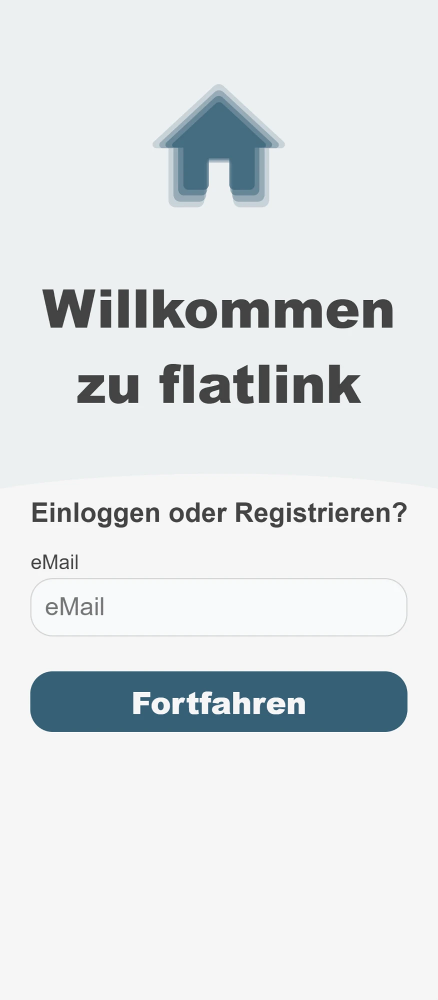
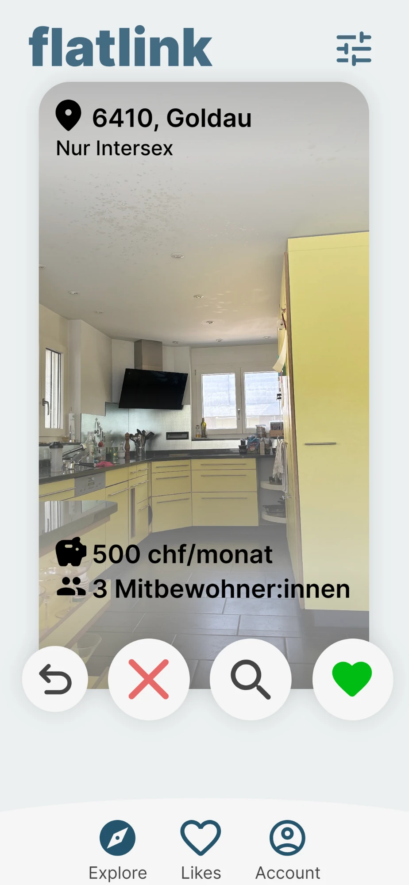
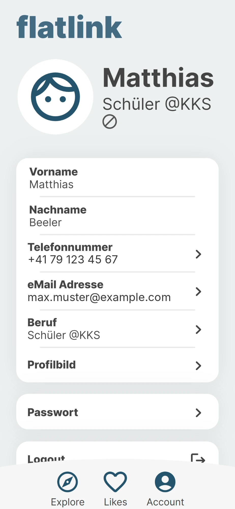

# flatlink

*Die App, um Deine WG zu finden.*

<table align="center">
  <tr>
    <td align="center" valign="top" width="260">
      <br>
      <b>Login</b><br>
      <sub>Enter your email to log in or sign up.</sub>
    </td>
    <td align="center" valign="top" width="260">
      <br>
      <b>Explore</b><br>
      <sub>Flat cards with location, rent and flatmates. Undo, dislike, view details or like.</sub>
    </td>
    <td align="center" valign="top" width="260">
      <br>
      <b>Account</b><br>
      <sub>Manage profile details, picture and password. The data shown is placeholder data.</sub>
    </td>
  </tr>
</table>

flatlink is a mobile-first web app that makes finding a shared flat (WG) in Switzerland easier. People looking for a room ("searchers") and people offering one ("providers") each fill in a preferences profile. An algorithm compares the two sides and shows the best matching profiles. Both sides can like or dislike each other and see the details of each match.

It was built as a Maturaarbeit (Swiss matura project, 2024) at the Kantonsschule Kollegium Schwyz, subject area computer science.

> **Status:** archived. The project is no longer maintained and is not running anywhere. It is published for reference.

## Features

- Signup for searchers and providers with a multi-step preferences questionnaire
- Matching based on 14 preferences (see below)
- "Explore" view with flat cards: undo, dislike, details and like
- "Likes" view for likes and matches, each with a detail view
- Email verification, password reset and email address change (signed, expiring tokens)
- Profile and flat images with server-side resizing
- Admin dashboard for managing user accounts
- Installable as a PWA (manifest, service worker, offline page)
- German-language UI with imprint and privacy pages (designed with the Swiss revised data protection act in mind)

## How the matching works

The target group is 18 to 40 year olds, who mostly use phones, so the UI is built mobile-first. Searchers and providers answer the same questions, and the algorithm turns each pair of answers into a score:

| Preference type | Examples | How it is scored |
|---|---|---|
| Scale 1 to 10 ("How important is …?") | accessibility, balcony, cleanliness, transport links, quiet atmosphere, washing machine, internet, number of flatmates | Inverse of the difference between both answers |
| Choices | flat size, room size, gender preference, eating habits | Match of the selected options (providers answer yes/no for amenities) |
| Budget | monthly budget vs. price | Points depending on how the budget relates to the price |
| Location | preferred location on a map | Relative air distance (via `geolib`) compared to the nearest and farthest flat on the platform |

The individual scores are combined into one match score per flat.

## Tech stack

| Part | Stack |
|---|---|
| Frontend | Node.js, Express, EJS templates, plain JavaScript and CSS |
| Backend (REST API) | Node.js, Express, Sequelize ORM |
| Database | PostgreSQL |
| Auth | JWT, bcrypt, `express-bouncer` against brute force |
| Email | Nodemailer with EJS email templates (email verification against fake accounts) |
| Images | `sharp`, `express-fileupload` |
| Maps and location | Leaflet with OpenStreetMap tiles, Nominatim and geocode.maps.co for geocoding, `geolib` for distances |

A web app was chosen over a native or hybrid app: it needs no compiling or app store and works on every device with a browser.

## Project structure

| Path | Purpose |
|---|---|
| `backend/` | REST API: routes, services (business logic), Sequelize models, email templates |
| `frontend/` | Server-rendered web app: routes, EJS views, static assets |
| `docs/` | Screenshots used in this README |
| `package.json` | Root scripts to start backend and frontend together |

### Routes

**Frontend** (port 3000)

| Route | Purpose |
|---|---|
| `/` | Logged out area: login, signup, forgot password, email verification, legal pages |
| `/user` | Everything for logged-in users |
| `/admin` | Admin dashboard |

**Backend API** (port 4000)

| Route | Purpose |
|---|---|
| `/accountService` | Accounts, including pictures |
| `/matchingService` | Matching, liking, disliking and fetching likes |
| `/adminService` | Admin dashboard data |

## Getting started

### Prerequisites

- [Node.js](https://nodejs.org)
- [PostgreSQL](https://postgresql.org), with an empty database created for development
- `nodemon` (`npm install -g nodemon`), used by the development scripts

### Installation

1. Install dependencies in the root, `backend/` and `frontend/`:

   ```bash
   npm install
   cd backend && npm install
   cd ../frontend && npm install
   ```

2. Create `backend/development.env`:

   | Variable | Description |
   |---|---|
   | `dbUserDev` | Dev database user |
   | `dbPassDev` | Password of that user |
   | `dbDev` | Dev database name |
   | `dbHostDev` | Dev database host (`localhost` if local) |
   | `jwtSecret` | Secret for signing JWTs |
   | `appUrl` | Frontend URL used in emails, e.g. `http://localhost:3000` |
   | `emailUser` | SMTP username (only needed to send emails) |
   | `emailPassword` | SMTP password (only needed to send emails) |
   | `emailUserName` | Sender address shown in emails |

3. Create `frontend/development.env`:

   | Variable | Description |
   |---|---|
   | `apiUrl` | `http://localhost:4000` |
   | `appUrl` | `http://localhost:3000` |
   | `jwtSecret` | Same value as in the backend |

   The `.env` files are git-ignored. Never commit them.

4. Start both apps in development mode, from the repository root:

   ```bash
   npm test
   ```

   On Windows use `npm run testWindows`. The database tables are created automatically on first start (Sequelize `sync`).

5. Open <http://localhost:3000>. The API runs on <http://localhost:4000>.

> **Note:** the root `package.json` scripts call `cd Backend` and `cd Frontend` with capital letters. On case-sensitive file systems (Linux) that fails. Either fix the casing or start each app yourself with `npm test` inside `backend/` and `frontend/`.

### Production

`npm start` runs both apps with `NODE_ENV=production`. The backend then reads `dbUser`, `dbPass`, `db` and `dbHost` instead of the `…Dev` variables. `PORT` can override the default ports.

The sender host `mail.nyv.ch` is hardcoded in `backend/services/mailer.js`, and the allowed CORS origins are listed in `backend/app.js`. Change both if you deploy your own instance.
